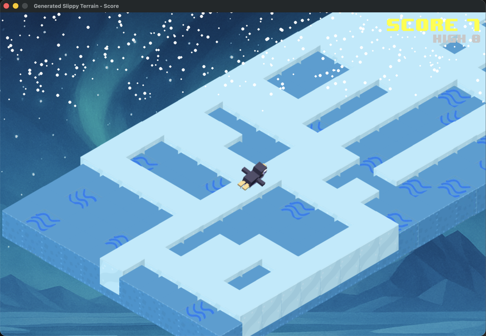
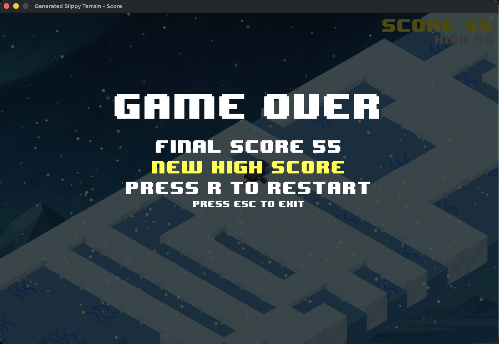

# Slippy Penguin — Isometric Endless Runner

A voxel-style, isometric endless-runner inspired by Crossy Road's "Slippy Penguin."  
Slide across procedurally generated ice, dodge water gaps, and push your high score while ambient wind howls and snow drifts around you.

---

## Screenshots





## Features

| Category  | Details |
|-----------|---------|
| Terrain   | Procedural ice path with random branches and turns; multi-layer isometric rendering via TMX. |
| Graphics  | 111 × 128-pixel voxel tiles, parallax background scroll, snow particle overlay. |
| Sprites   | Three penguin poses (forward, left, right) auto-scaled and depth-sorted. |
| Audio     | Looping wind, turn "swoosh," milestone chime (pitches up every 25 points), and lose stinger. |
| Gameplay  | Smooth camera follow, constant acceleration, high-score tracking, instant restart (R) or quit (Esc). |

---

## Project Structure

```
.
├── main.py                # Game source
├── assets/                # Map, tileset, sprites, audio, font, and high score
├── Tiled-main/            # Source Tiled project and additional assets
└── README.md
```

---

## Requirements

```
python >= 3.10
pygame >= 2.4
pytmx   >= 3.32
numpy   >= 1.24
```

Install dependencies:

```bash
pip install pygame pytmx numpy
```

## Running the Game

```bash
python main.py
```

## Play in the browser

The game can also be packaged for the browser with Pygbag. The Vercel build uses the same command and publishes the generated WebAssembly app.

```bash
python3 -m pip install pygbag
python3 -m pygbag --build --template pygbag-template.html --width 1200 --height 800 .
```

## Controls

| Key | Action |
|-----|--------|
| ← / A | Turn left |
| → / D | Turn right |
| ↑ / W | Continue forward |
| R | Restart after death |
| Esc / Q | Quit |

Every 25-tile milestone plays an increasingly higher-pitched "ding." Falling off the path or leaving the map ends the run.

## Modding

* **Tileset** - edit the Tiled project under `Tiled-main/` and keep the game's asset paths in sync.
* **Backgrounds** - add additional `assets/bg*.png` files; one is chosen randomly on start.
* **Audio** - replace the files under `assets/` while keeping the milestone clip short and percussive.
* **Font** - the game prefers `assets/8-BIT WONDER.TTF`; if absent, it falls back to the system font.
